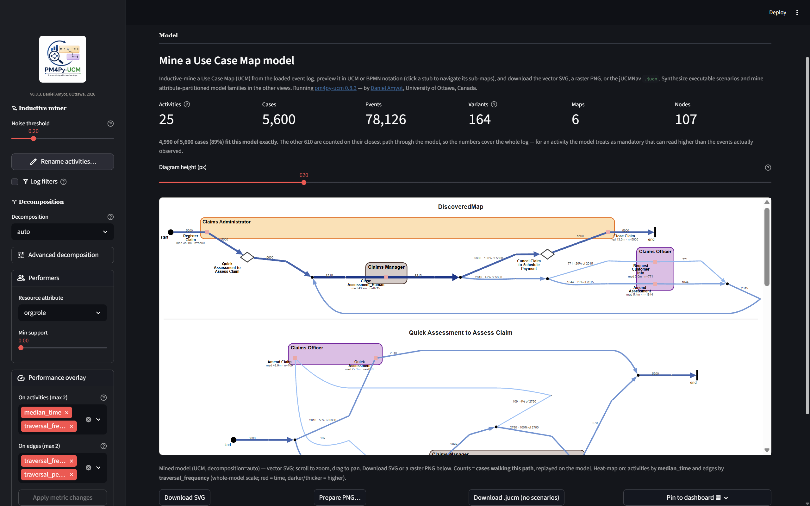
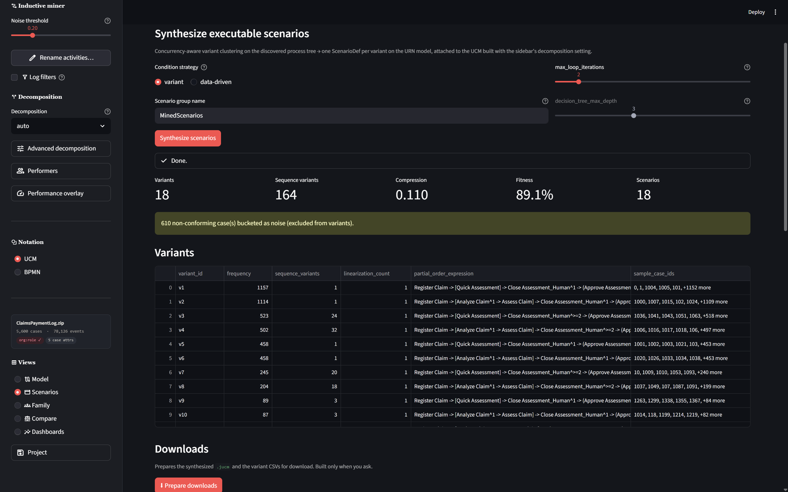
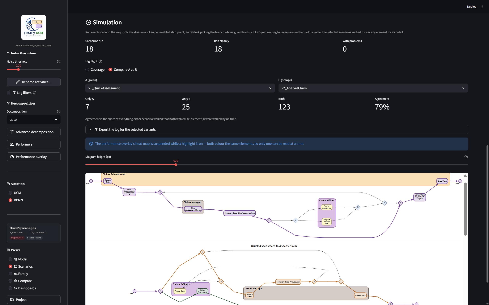
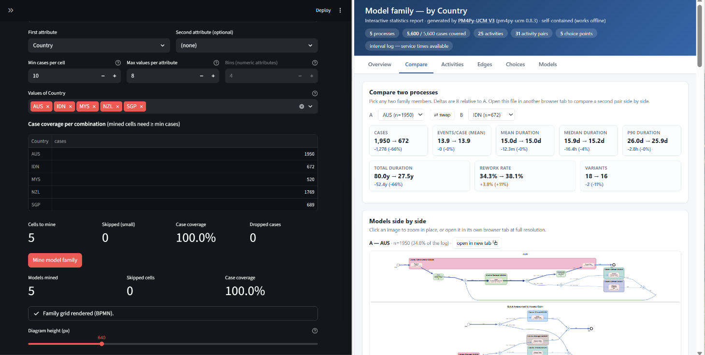
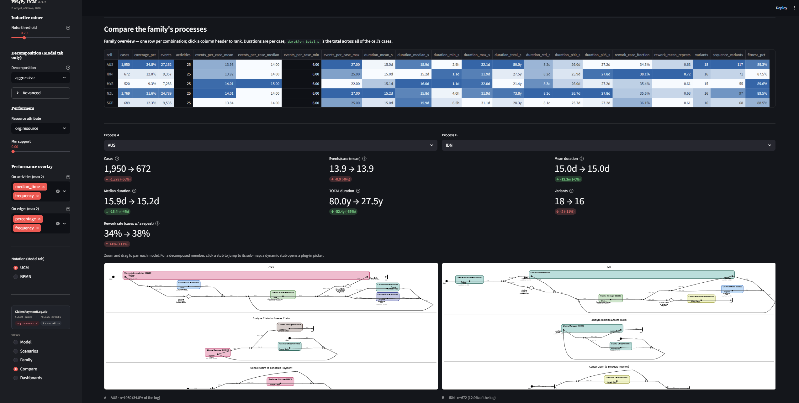
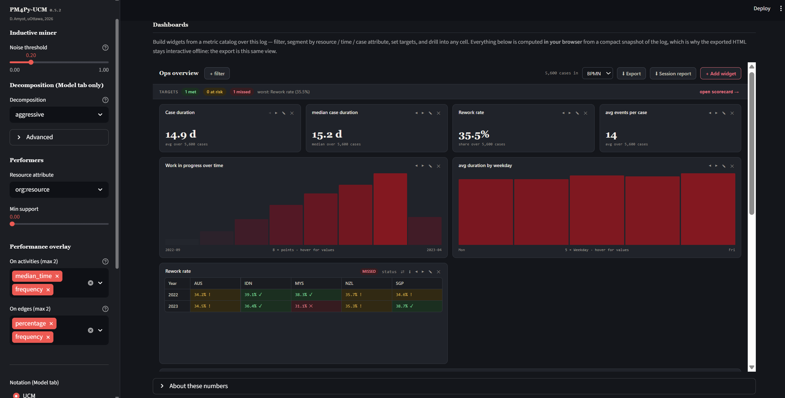

# pm4py-ucm web front-end

A [Streamlit](https://streamlit.io) front-end for the `pm4py-ucm` package,
deployed at <https://pm4py-ucm.streamlit.app/>. Load an event log (XES or
CSV) and, from a left-rail workspace, mine and render **UCM models** (UCM or
BPMN notation, as navigable SVG), synthesize and simulate executable
**scenarios**, mine attribute **model families**, **compare** family
members, and build interactive **dashboards** — downloading `.jucm`,
standard **BPMN 2.0**, CSV, SVG/PNG and self-contained HTML along the way.

The app is **V6**, `streamlit_app_v6.py`; `streamlit_app.py` is a shim that
runs it. Everything before V6 is deprecated — see
[Deprecated app versions](#deprecated-app-versions).

- [Run locally](#run-locally)
- [The views](#the-views)
- [Using the app](#using-the-app): [log](#1--pick-or-upload-a-log) ·
  [CSV mapping](#2--csv-column-mapping-csv-uploads-only) ·
  [cost screen](#3--the-cost-screen) · [sidebar](#4--sidebar) ·
  [Model](#5--model) · [Scenarios](#6--scenarios) · [Family](#7--family) ·
  [Compare](#8--compare) · [Dashboards](#9--dashboards) ·
  [projects](#10--save-share--resume-a-project)
- [Deploy to Streamlit Community Cloud](#deploy-to-streamlit-community-cloud)
- [Robustness & security notes](#robustness--security-notes)
- [Deprecated app versions](#deprecated-app-versions)
- [Layout](#layout)

## Run locally

Requires Python 3.10+ and the [Graphviz](https://graphviz.org/download/) `dot`
binary on `PATH` (the layouter shells out to it).

From the repo root:

```bash
python -m venv .venv
.venv\Scripts\activate            # Windows
# source .venv/bin/activate       # macOS/Linux

pip install -r web/requirements.txt
streamlit run web/streamlit_app_v6.py
```

Streamlit opens `http://localhost:8501`.

`web/requirements.txt` holds what the app needs beyond the package:
`streamlit` (1.57 or later, below 2), `pm4py` (an optional extra of the
package, so it is listed explicitly) and `-e .`, the package itself with its
core dependencies. `-e .` resolves against pip's working directory — the
repo root, both locally and on Streamlit Cloud — so a change to the library
is picked up on the next rerun (locally) or deploy (on the Cloud).

## The views

A left rail switches between five views over the loaded log. The sidebar
settings, the log filter and the activity renaming apply to all of them.

- **Model** — mine a UCM and preview it in BPMN or UCM notation as a zoom /
  pan SVG (click a stub to jump to its plug-in map), with a performance
  overlay and heat-map. Download the SVG, a PNG, the `.jucm`, a standard
  BPMN 2.0 file, or the (filtered) event log.

  

- **Scenarios** — concurrency-aware variant clustering and one executable
  jUCMNav `ScenarioDef` per variant, with variant-driven or data-driven
  OR-fork conditions.

  

  A **Simulation** section then runs those scenarios the way jUCMNav does
  and colours the model with what they walked: coverage of any subset, or
  two scenarios compared.

  

- **Family** — partition the log by one or two case attributes and mine one
  model per combination, shown as a grid.

  

- **Compare** — rank the family members on heat-mapped statistics tables
  and compare any two side by side.

  

- **Dashboards** — build widgets from a metric catalog, or let
  **✦ Suggest** propose whole dashboards from the log, and export them as
  self-contained interactive HTML.

  

## Using the app

### 1 · Pick or upload a log

The **Log source & columns** panel at the top of the page has two tabs:

- **Sample log** — pick one of the bundled logs and click **Load sample**.
  The list is whatever is in [`web/samples/`](samples): drop in a `.xes`,
  `.xes.gz`, `.zip` or `.csv` file and it appears on the next start, named
  after the file (underscores become spaces, extensions stripped).
- **Upload your own** — the uploader accepts:
  - **`.xes`** / **`.xes.gz`** — mined directly.
  - **`.zip`** — searched for the first `.xes` / `.xes.gz` entry inside.
  - **`.csv`** / **`.csv.gz`** — a column-mapping section appears after
    upload (step 2).

  The upload cap is **1 GB when running locally** and **75 MB on the public
  Community Cloud deployment**. The server layer allows 1 GB everywhere
  ([`.streamlit/config.toml`](../.streamlit/config.toml)); the app enforces
  the tighter 75 MB when it detects Community Cloud (through the `HOSTNAME`
  / `/mount/src` fingerprints). A self-hosted deployment gets the 1 GB
  ceiling.

Once a log is chosen its bytes are cached for the session, so changing any
setting re-uses it; the panel collapses once mining can proceed. Above it,
**Resume a saved project** loads a project file instead (step 10).

### 2 · CSV column mapping (CSV uploads only)

For a CSV, these controls appear under **CSV columns**:

| Field | Required? | Notes |
|---|---|---|
| Case id column | ✓ | Trace identifier |
| Activity column | ✓ | Event name |
| Timestamp column | ✓ | ISO-8601, most other date formats, or integer epochs (seconds → ns) |
| Role column (optional) | — | Renamed to `org:role` for performer mining |
| Resource column (optional) | — | Renamed to `org:resource` for performer mining |
| Day-first dates | — | Read `03/06/2024` as 3 June, not 6 March. ISO dates are unaffected. A warning appears when the column reads differently both ways. |

Sensible defaults are auto-detected from common column names
(`case:concept:name`, `concept:name`, `time:timestamp`, `org:role`, `Resource`,
`Assignee`, …). Review them, adjust if needed, then click **Apply column
mapping** to start mining. Mining is *blocked* until this button is clicked
on a fresh upload, so the miner never runs against a wrongly-guessed mapping.
A mapping whose timestamp column does not read as dates is refused on Apply,
with the column named and its first values shown.

The file may be comma-, semicolon-, tab- or pipe-delimited, in UTF-8 (with
or without BOM), UTF-16 or Windows-1252 — both are detected.

Any column may fill any role — including one already named `concept:name`,
`org:role`, etc. The role/resource columns are mapped to `org:role` /
`org:resource` *before* the log is formatted, so picking a role column that
happens to be named `concept:name` (e.g. a log where the phase sits in
`concept:name` and the activity in another column) maps cleanly instead of
colliding with the canonical activity column.

Changing the dropdowns after the initial Apply shows a yellow banner and a
re-apply button — but mining keeps using the last-applied mapping in the
meantime, so other sidebar settings remain responsive.

### 3 · The cost screen

On a log with a large alphabet or near-unique cases the miner can run for
minutes, or not finish. The app screens the log **before** mining and, when
it looks expensive, stops to say so rather than spending the time silently.
Most logs pass the screen and never see it.

The verdict is a **reason, not an ETA** — the statistics that rank logs
correctly cannot time them. The panel shows activities / cases / events /
variants (as *kept / original* once a filter is on) and what tripped the
screen. Reducing the log is the only remedy that keeps the model usable;
faster miner settings return a flower model with every activity and no
control flow, which leaves nothing to cluster or synthesize from.

**The two one-click reductions.** The gate offers the two reductions that
address the two conditions it screens for, next to **Mine using my
filters**:

* **Keep the 2,000 most frequent variants** — drops rare *behaviour*,
  keeping every activity. Usually the bigger win, because the number of
  distinct sequences drives the cost.
* **Keep the 50 most frequent activities** — drops rare *activities*; they
  disappear from the model and the alphabet shrinks.

Both apply, in either order, and each re-checks the log afterwards so you
can apply the second before mining. Each appears in the sidebar's **Log
filters** with its own *Remove* button, survives a refresh, and travels in a
saved project.

Each reduction is recorded as **what it selected** — the variant one keeps
the *cases* it picked on the log as it stood when you clicked it, the
activity one names the *activities* — not as "top N by rank". A rank is
relative to a population that every other filter moves, so a later filter
can never silently widen a reduction.

**The replay gate.** The model itself is cheap once mined; the replay-based
metrics (coverage, traversal counts) are a second pass that on a big log
dominates everything. Unlike mining, that cost *can* be measured, so the app
probes rather than guesses. Most logs finish inside the probe and are never
interrupted; when they do not, you are told the estimate and can compute the
metrics, drop them, or defer. On the cost screen itself, **Skip replay-based
metrics for this log** makes that choice up front. Time metrics such as
sojourn are read straight from the log and are computed either way.

Answering the prompt changes only the metrics — the mined model and the log
filters stay exactly as they were.

### 4 · Sidebar

The sidebar holds the settings that apply to every view, in this order, then
the view switcher and the **Project** group (step 10).

#### Inductive miner — Noise threshold

The IMf (*Inductive Miner — infrequent*) threshold. `0.0` keeps every observed
behaviour (classic Inductive Miner, perfect fitness, often noisy diagrams);
higher values filter out increasingly rare arcs and activities, producing
smaller and more abstract models. **0.2 is the default and a sensible
practical starting point**; useful range is roughly 0.1 – 0.4.

#### Rename activities

**Rename activities…** opens a dialog to relabel or merge activities before
the miner runs (give two activities the same new name to merge them). The
map can be seeded from a CSV / JSON file and exported as JSON; nothing
changes until **Apply**.

#### Log filters

Tick **Log filters** to pre-filter the log before mining. The range sliders
have two handles, so you can keep the most frequent, the least frequent, or
a middle band:

- **Activities by frequency rank** — keep activities whose rank falls in the
  selected band (rank 1 = most frequent); plus an **Exclude activities** list.
- **Attribute filter (ƒ)** — a one-line predicate over case attributes, using
  the **same ƒ grammar as a custom dashboard metric**: keep the cases it
  evaluates true for. Categorical: `attr("Channel") == "Web"` (or `!=`, OR-ed
  for a set — `attr("Channel") == "Web" or attr("Channel") == "Phone"`).
  Numeric / temporal: `attr("amount") > 500 and duration() < 30`, also
  `count("Act")`, `contains("Act")`, `time_between(a, b)`, and `and` / `or` /
  `not`. The detected attribute names are listed under the box; an invalid
  expression shows an inline error and is ignored until fixed.
- **Date range** — a slider over the log's own span, with a **cases in the
  window** choice (*intersecting* or *fully inside*).
- **Cycle-time percentile (case duration)** — a two-handled band over each
  case's **end-to-end cycle time** (last − first event): `0` = fastest,
  `100` = slowest, so `0–10` keeps the fastest 10% of cases and `90–100` the
  slowest 10%. (Shown only when the log has a real time span.)
- **Variants by frequency rank** — keep trace variants in the selected band,
  with a **top variants by case coverage %** box synced to the slider. It
  comes last because it ranks the variants of the log the filters above
  leave.

Each is a standard pm4py log filter applied before inductive mining, after
the renaming. Both transforms are **global** — every view and every export
works over the same renamed, filtered log — so changing one re-mines. The
Model view's Activities, Cases and Events metrics then read
**selected / total**.

#### Decomposition

- **off** — single flat map.
- **auto** (default) — split into a root map plus plug-in maps, with the map
  size **fitted to the mined tree's shape** (`suggest_decomposition`): the
  `max_leaves_per_map` cap scales sub-linearly (≈ 1.5·√N in the tree's
  activity-leaf count N) and the `min_leaves_to_decompose` floor scales with N,
  so a small model stays flat while a large one splits into readable,
  not-too-many maps.
- **Pre-set: Max=8/Min=4** and **Pre-set: Max=6/Min=3** — pin those fixed
  dimensions instead of fitting them, for when you want a specific granularity.
- **Custom** — set `max_leaves_per_map`, `min_leaves_to_decompose` and
  `balance_ratio` by hand.

All modes decompose on **every** operator kind. Any non-off mode reveals an
**Advanced decomposition** expander with the four toggles
(`on_root_sequence`, `on_parallel`, `on_alternative`, `on_loop`) — all on by
default — if you ever want to exclude one; under **Custom** the size inputs are
editable there, and `auto` / the pre-sets show their values as a caption. Click
**Apply changes** to remine. See the main README's
[Hierarchical decomposition](../README.md#hierarchical-decomposition)
section for what each key does.

#### Performers

- **Resource attribute** — pick from `org:role` (default), `org:resource`,
  `Other...` (a custom event-attribute name, or a comma-separated fallback
  list like `org:role, org:resource, org:group`), or `(none)` to skip
  performer mining entirely.
- **Min support** — minimum fraction of events for an activity that must
  agree on a performer before the binding is kept. `0.0` (default) accepts
  the modal performer even when the resource pool is highly dispersed;
  raise this if you want only majority-owned activities to be bound.
  Disabled when performer mining is off.

#### Performance overlay

Annotates the model with up to two activity metrics and two edge metrics
(traversal counts, frequency, coverage, service / waiting / sojourn times, an
OR-fork branch's share …) — shown as a small gray sub-line. Every available
metric is written to the `.jucm` as jUCMNav metadata, whichever two are
shown. Because changing a metric re-annotates the model, the pickers stage
behind an **Apply metric changes** button. The defaults are a time metric
(service time on a log with start and end timestamps, sojourn time
otherwise) and the traversal count on activities, and the traversal count
and branch share on edges.

*Which count?* `traversal_frequency` / `traversal_percentage` count how often
the log **walks the model**, by replaying the log on the mined process tree.
They are the ones that **add up**: an activity's count equals the count on
its own edges, every branch of a parallel fork carries the fork's inflow,
and a choice's branches sum to it. The older `frequency` counts events
(activities) and *directly-follows pairs* (edges) — how often two activities
were **adjacent in a trace** — which on a model with parallel or silently
skipped branches is much smaller than the real flow. Both remain available;
the diagram caption says which is in use, and a share is shown with the base
it divides ("25 % of 258"). See [`docs/metrics.md` §9](../docs/metrics.md).

*Too slow?* The traversal counts are the only ones that need the log
replayed on the model, and on a log with thousands of distinct variants that
replay is the longest step of a mine. A run cannot be interrupted once it
starts, so the choice is made up front: untick **Replay the log for
traversal counts** and the traversal metrics fall back to their event-based
counterparts (`traversal_frequency` → `frequency`, `traversal_percentage` →
`percentage`), which are cheap but do not conserve. The counts are never
estimated from a half-finished replay. Your metric picks are untouched, so
ticking the box again restores the conserving counts, and both the picks and
the opt-out are saved with a project and with the exported Python script (as
`OVERLAY_REPLAY`).

**Heat-map emphasis** (on by default once a metric is shown) additionally
colours and thickens activities and edges by the value of the **first**
metric of each layer: a **time** metric drives a **red** ramp, any other a
**blue** one, with lighter/thinner = lower and darker/thicker = higher. It
applies across the **Model, Family and Compare** views. The **Heat-map
scale** is three-way:

- **Local (per map)** — each diagram on its own min/max, so every sub-map
  shows its own hotspots.
- **Per family member (across its maps)** (default) — every map of a model
  on that model's min/max, so a value reads the same across its maps;
  coincides with local when the model is not decomposed.
- **Global (across family members)** — every cell of the Family / Compare
  views on **one shared range**, so a colour is comparable across members;
  in the Model view it is the whole model.

In BPMN the activity box is tinted under a stronger, thickened contour; in
UCM the responsibility marker itself colours and grows with the value. A
path keeps one colour and thickness across its routing points (empty points)
up to the next real node. It is a render-time overlay — the SVG and PNG
match it, and the `.jucm` is unchanged. The heat-map's on/off and scale
travel with a saved project.

#### Notation

- **BPMN** (default) — Activity boxes for responsibilities, gateway diamonds
  with `X` / `+` markers, BPMN-canonical start / end events. The notation most
  readers already know, so it is what the app shows out of the box.
- **UCM** — Z.151 / jUCMNav notation. Filled circle for the start
  point, perpendicular bar for the end point, small black square + name for
  each responsibility, synchronisation bars for AND-forks/joins, dots for
  OR-forks/joins, diamond reserved for stubs.

Switching notation re-renders the diagram but does **not** re-run the miner.

### 5 · Model

Once mining completes, the **Model** view shows a metrics row (activities,
cases, events and variants — selected/total when filtered — plus maps and
nodes) and the diagram as a **vector SVG** in a zoom / pan viewer — scroll
to zoom, drag to pan, and for a decomposed model **click a stub** to jump to
its plug-in map (a dynamic stub opens a picker of its preconditioned
plug-ins), and click a plug-in map's **end point to jump back to its
parent**.

*How much of the log does this describe?* Under the metrics row the view
reports how many cases fit the model exactly — e.g. "4,990 of 5,600 cases
(89 %)". A model mined with a **noise threshold** deliberately drops
infrequent behaviour, so it explains only part of its log; the remaining cases
are counted on their closest path through the model, so the numbers still
cover everything (for an activity the model treats as mandatory that can read
higher than the events actually observed). Below 70 % the note becomes a
warning suggesting a lower noise threshold — `0.0` explains every case, at the
cost of a busier model. See [`docs/metrics.md` §9](../docs/metrics.md).

Downloads:

- **Download SVG** — the vector render (crisp at any zoom, text
  selectable).
- **Prepare PNG…** → **Download PNG** — a raster render, generated on
  demand.
- **Download .jucm** — the model in jUCMNav's native XMI format, ready to
  open in [jUCMNav](https://github.com/JUCMNAV/jUCMNavPlus).
- **Prepare BPMN…** → **Download BPMN** — the model as a standard
  **BPMN 2.0** file with diagram interchange, for bpmn.io, Camunda Modeler
  or `pm4py.read_bpmn`. Components become lanes, so the maps are laid out
  in horizontal swim-lanes (the picture may differ from the on-screen one);
  each composite activity is a collapsed sub-process you can drill into;
  the active heat-map rides along as colours. The mapping is in
  [`docs/bpmn_export.md`](../docs/bpmn_export.md).
- **Pin to dashboard** — adds the live model as a widget in the Dashboards
  view. The pinned widget is itself a zoom / pan viewer, not a flat image,
  and follows a re-mine.
- **Event-log export** — **⬇ Prepare log export** → **Download XES** /
  **Download CSV**: the log the model was mined from, with the active
  filters applied.

### 6 · Scenarios

Choose a **condition strategy** — *variant* (lossless; every OR-fork
guarded by `variant_id == v_i`) or *data-driven* (a decision tree per
outside-loop fork turns case attributes into a business-readable rule) —
a scenario-group name, the per-variant loop-iteration cap and, for
data-driven mode, the decision-tree depth, then click **Synthesize
scenarios**. The view reports headline metrics (variants, sequence
variants, compression, fitness, scenarios, and per-fork condition-mining
accuracy in data-driven mode). A single **⬇ Prepare downloads** button then
builds the `.jucm` (with the synthesized `<scenarioGroups>`), `variants.csv`,
`case_variant_map.csv`, and (data-driven) `condition_mining.csv` — the
`.jucm` is serialized only when you ask. Works on flat and decomposed models
alike.

#### Simulation (bottom of the Scenarios view)

Once scenarios are synthesised, the section at the bottom of this view runs
each one the way jUCMNav does — a token per enabled start point, an OR-fork
picking the branch whose guard holds, an AND-fork spawning a token per arm,
an AND-join waiting for every one — and reports the same problem kinds
jUCMNav lists in its Problems view. A decomposed model is traversed into its
plug-in maps, so a stub is descended rather than skipped. The semantics are
specified in [`docs/scenario_simulation.md`](../docs/scenario_simulation.md).

Two highlight modes over the mined model:

* **Coverage** — pick any number of scenarios; what they walked is
  coloured, and the numbers are reported as **Elements** (path nodes: start
  and end points, responsibilities, forks and joins, stubs) and **Paths**
  (the segments between them), against the **whole model**. The split
  matters: a run can walk every node and still miss segments, so elements at
  100% with paths below it means what is left over is empty alternatives
  rather than unexercised behaviour. A breakdown per element kind is one
  click away. Coverage is a set, so a loop that enters an element nine times
  covers it once, and a single scenario reads low by design — it walks one
  path through a model containing every path.
* **Compare A vs B** — pick two scenarios; what only **A** walked is dark
  green, only **B** dark orange, and what **both** walked purple, with the
  three counts, an agreement figure, and how many elements neither touched.
  The pair differs in lightness as well as hue, so it survives a greyscale
  printout.

Every element carries hover text saying what it is and whether these
scenarios walked it. The performance overlay's heat-map is suspended while a
highlight is on — both colour the same elements, so only one can be read at
a time — and the app says so rather than letting it appear to vanish.

**Export the log for the selected variants** reduces the event log to the
cases of the selected scenarios' variants (XES and CSV, with the global
filter already applied). Cases that replayed as noise belong to no variant
and drop out, which makes this a way to clean a log.

The mode and the selected scenarios are part of the session: a saved project
resumes into the same highlight, and an exported script reproduces it (step
10). Scenarios are remembered by **name**, so if you re-mine at a different
noise threshold and a scenario is gone, the selection falls back to the
defaults instead of quietly highlighting a different one.

### 7 · Family

A **💡 Suggested attributes** table ranks the case attributes by
**discriminative power** — how much the process actually changes across each
attribute's values (control-flow divergence + case-duration effect, discounting
identifiers and near-constant fields) — so the picker isn't a blind guess. It is
fully **deterministic** (no LLM; `pm4py_ucm.rank_partition_attributes`); when
nothing scores high it says so, rather than pretend.

Pick **1–2 case attributes**; a **coverage heatmap** previews the cell
sizes *before* mining, with per-value filters, a minimum number of cases per
cell, a cap on values per attribute (the rest merge into *Other*), and
quantile bins for numeric attributes. Mine to get one model per
combination, shown as a **2-D SVG grid** (rows × columns). A single
**⬇ Prepare downloads** button then builds the download-only artifacts —
the per-cell `.zip`, the combined `.jucm` (shared definitions), the
dynamic-stub **umbrella** `.jucm` (one plug-in per variation point, with
executable strategies; optionally merging behaviourally identical
plug-ins), the grid as **SVG** and **PNG**, the self-contained
**interactive HTML statistics report**, and a **BPMN 2.0 `.zip`** (one
`.bpmn` per cell plus the umbrella as `family_umbrella.bpmn`, on the
family-wide heat-map scale when that scope is selected) — plus the
umbrella's variation-point counts. They are built only when you ask, so
mining a family just to browse the grid stays fast. See
[`docs/model_families.md`](../docs/model_families.md).

### 8 · Compare

Rank the family members on a heat-mapped statistics table (per-cell cases,
durations incl. **total**, events/case, variants, rework), then pick any
two and see them **side by side**: SVG models (each downloadable as SVG or
PNG), delta cards, per-activity and per-edge Δ tables on a metric of your
choice, and aligned OR-fork branch shares. The same interactive HTML report
is downloadable from here.

### 9 · Dashboards

An embedded, self-contained dashboard island over the log's per-case
**fact table** — and the *same artifact* the HTML export writes, so what
you build on screen is exactly what you ship. It is computed in the browser,
and the widgets you add are stored in the browser too, per log; they reach
the server only when you save a project (step 10).

**Start from a suggestion.** A log's first dashboard opens on an
**Overview** chosen for that log, and the green **✦ Suggest** button opens a
gallery of further dashboards the log supports — *Bottlenecks*, *Rework and
flow*, *Segments* — each widget with the sentence and the number that
justify it. **Add** creates a new named dashboard (or fills the current one
if it is empty); nothing you built is replaced. Suggested KPIs carry a
target prefilled with today's value but switched off: turn it on in the
widget's editor once you have decided the goal. Each proposed dashboard
follows its headline KPIs with the whole picture — sojourn for **every
activity**, activity × month and activity × attribute heatmaps — and a
*Behavioural variants* dashboard appears when the model's replay was run: it
segments by the **concurrency-aware variants** of the Scenarios view (same
`v1`, `v2`, …), in which two orders of the same parallel work are one
variant. The rules are in
[`docs/dashboard_suggestions.md`](../docs/dashboard_suggestions.md).

**Every activity at once.** For a per-activity metric (sojourn, service,
waiting, frequency, presence, repeats, and the rework rate `actRework` — of
the cases performing an activity, the share performing it more than once)
the segment pickers offer **Activity (every one)**: one bar per activity, or with a second axis
a heatmap of activity × month, × attribute or × behavioural variant.

**Build a widget.** Pick a metric from the catalog (or write your own in
the [ƒ formula language](#the-ƒ-custom-formula-language)), choose an
**aggregation**, add per-widget or dashboard-level **filters** (including a
**date range**), and **segment** by up to two axes. A live preview draws the
real widget as you compose it.

**Choose a shape.** The Chart row offers thumbnails of the visualisations
that say something true about what you picked:

| Segmentation | Shapes offered |
| --- | --- |
| no axes | **KPI card**, **histogram** or **box plot** (the distribution) — plus a **gauge** when the widget has a target |
| one axis | **bar**; a **line** on a time axis; a **pie / donut** when the aggregation is a `sum` |
| two axes | a **heatmap table** |

Bar charts, line charts and histograms carry a labelled value axis, and
bars are drawn proportionally from zero.

**Targets and the scorecard.** Set a target and watch the **scorecard**. A
segmented target rolls up to one state — so its row **expands to the
segments that breached it**, and clicking one filters the whole dashboard
to that segment.

**Arrange.** Drag a widget's grip to reorder it, drag its corner to
resize; the layout is remembered.

**Several dashboards.** A log can hold several **named dashboards** —
switch from the header dropdown (New / Rename / Delete). Each keeps its
own widgets and filters.

**Take it with you.**

- **⬇ Export** — this dashboard as one self-contained interactive HTML
  file: offline, no server, still filterable.
- **⬇ Export all** — every dashboard in one file, switchable, read-only.
- **⬇ Session report** — a multi-section report (scorecard + dashboards +
  the model as SVG + a Family section).
- **⬇ Save / ⬆ Load** — the dashboard's *definition* (widgets + filters)
  as a small reusable JSON, reloadable here or on **another log**; widgets
  naming activities or attributes the target log lacks are reported up
  front rather than shown as misleading zeros.

The exact metric definitions and the engine's rounding / weighting
decisions are documented in [`docs/dashboards.md`](../docs/dashboards.md);
a runnable walkthrough is
[`demo/dashboards_tutorial.ipynb`](../demo/dashboards_tutorial.ipynb).

#### The ƒ custom-formula language

When the catalog doesn't name what you want to measure, write it as a
**custom formula**: a per-case expression, optionally narrowed by a
`where` clause, that the dashboard then aggregates (avg / median / share /
…) exactly like any built-in metric. Choose **ƒ Custom formula…** in the
widget composer's metric list; a live chip validates as you type and shows
the inferred result type, and function chips insert the calls below. The
same language is the sidebar's **Attribute filter (ƒ)**.

**Functions** — each returns one number per case:

| Function | Returns |
| --- | --- |
| `duration()` | case length, in days |
| `contains("act")` | `1` if the case contains activity *act*, else `0` |
| `count("act")` | how many times *act* occurs in the case |
| `time_between("a", "b")` | days from the first *a* to the first *b* after it; null if that never happens |
| `timestamp("act")` | epoch seconds of the first *act*; null if absent |
| `attr("name")` | a **numeric** case attribute; null if absent or non-numeric. For a categorical one use the equality form `attr("name") == "value"` (or `!=`), which yields `1` / `0` |

**Operators**, from lowest to highest precedence: the trailing `where` <
`or` < `and` < `not` < comparisons (`==` `!=` `>` `>=` `<` `<=`) < `+` `-`
< `*` `/` < unary `-`. Group with `(` … `)`. A comparison or a logical
yields `1` / `0`, so it reads as a percentage after aggregation.

**`where`** — a trailing `where <predicate>` keeps only the cases the
predicate holds for and sets the rest to null (which aggregation drops), so
`duration() where contains("Appeal")` measures duration over appealed
cases only.

**Examples**:

| Formula | Measures |
| --- | --- |
| `duration() where attr("Claim_Value") > 500` | case duration, over claims above 500 |
| `contains("Appeal")` | share of cases that were appealed → *percent* |
| `count("Rework") / count("Assess")` | rework ratio per case |
| `time_between("Register", "Pay") where attr("Claim_Value") > 1000` | register → pay days, high-value claims only |

**One value type, and no `eval`.** Every expression evaluates, per case, to
a **number or null**. A string only ever *names* an activity or attribute
inside a call, or the value in a categorical equality; it is never a runtime
value, and a bare string anywhere else is an error. The text is parsed to an
explicit syntax tree and never handed to a language `eval`, so the only
operations are the ones above, over the only data the fact table holds —
nothing you type can reach the host. `null` (a missing time, an absent
attribute) propagates through arithmetic and comparison and is dropped by
aggregation.

**Result type** is inferred from the expression and picks the unit and the
aggregations offered: a comparison, a logical, or a bare `contains()` is a
0/1 indicator → **percent** (aggregate with *share*); anything mentioning a
time function → **time**; otherwise → **count** — exactly as a catalog
metric's type does.

The canonical specification, with the full grammar, is the module docstring
of [`formula.py`](../pm4py_ucm/algo/dashboards/formula.py); see
[`docs/dashboards.md`](../docs/dashboards.md) for how it fits the rest of
the engine.

### 10 · Save, share & resume a project

The whole session is a project you can put down and pick back up, or hand to
a colleague. The sidebar's **Project** group offers two saves:

- **⬇ Save settings** → `<log>.ucmproj.json` — the *configuration only* (miner
  settings, CSV mapping, renaming, filters, performers, overlays,
  decomposition, family and scenario settings, the Simulation highlight, the
  open view, and your dashboards). Small and email-able; carries **no event data**, so it's the
  privacy-preserving way to share when the log is sensitive.
- **⬇ Save project bundle** → `<log>.ucmproj.zip` — everything above **plus the
  event log**, so it is self-contained and one-click to resume (it does ship
  the data).

Resume either from **Resume a saved project** at the top of the page: a
bundle brings its own log; a settings file re-uses the loaded log or asks you
to re-supply it (matched by hash, with a warning on a mismatch). Only *inputs*
are stored — the model, scenarios, family, reports and dashboards **recompute**
on load, so project files stay tiny and never go stale against a change in how
a model is mined. Dashboards travel through a small versioned bridge that reads
the browser-island widgets back on save and restores them on resume (**↻
Refresh dashboards from browser** re-reads them if you have just edited
one); the Family view re-mines automatically the first time you open it
after a load, and Compare follows. The design (a single parameter registry,
CI drift guards on both the save **and** restore sides, versioned schema) is
documented in [`docs/sessions.md`](../docs/sessions.md), and
[`demo/sessions_tutorial.ipynb`](../demo/sessions_tutorial.ipynb) is a runnable
walkthrough of the underlying `web/sessions` API.

The **Project** group also has a single **⬇ Export Python (.py + .ipynb)**
download — a zip with the current session emitted **both** as a runnable script
and as a notebook, over the public `pm4py_ucm` API: log loading, the pre-mining
rename + filters, mining, decomposition, performers, the performance overlay
and the model export, with check-boxes to add the **scenario-synthesis**
(followed by the simulation highlight the app was showing), **model-family**
and **dashboards** pipelines (all pre-selected). The notebook is laid out as
a tutorial — each stage defines its function, runs it, and shows the result
inline. Because a project stores only *inputs*, both are a faithful,
deterministic replay (no LLM — a template emitter). It's the way to take a
GUI exploration to an automatable, version-controllable pipeline; what the
script writes is described in [`docs/code_export.md`](../docs/code_export.md).

## Deploy to Streamlit Community Cloud

1. Push this repo to GitHub.
2. At <https://share.streamlit.io>, "New app" → pick the repo and branch.
3. Set **Main file path** to `web/streamlit_app_v6.py`. Streamlit Cloud
   picks up `web/requirements.txt` automatically (it sits next to the
   main file). The existing deployment points at `web/streamlit_app.py` —
   a shim that runs V6 — so it keeps working without a settings change.
   Pointing a deployment at one of the deprecated apps still works, but it
   will render their deprecation notice to every visitor.
4. **`packages.txt` (apt packages) MUST be at the repo root** — Streamlit
   Cloud's apt-install phase only reads from the root, not from the main
   file's directory. The root `packages.txt` in this repo installs the
   `graphviz` apt package, which provides the `dot` binary the layouter
   shells out to.
5. Deploy.

Updates are a `git push` to the tracked branch.

## Robustness & security notes

The app is designed for a low-traffic public demo (Streamlit Community
Cloud or similar). A few hardening points worth knowing:

- The upload cap is two-tier — 1 GB locally, 75 MB on Community Cloud (see
  [step 1](#1--pick-or-upload-a-log)).
- The Pillow decompression-bomb guard is raised to **1 billion pixels**
  rather than disabled. Realistic mined UCMs are far below that.
- CSV reading uses `low_memory=False` so columns with mid-file dtype
  changes don't trigger `DtypeWarning` or downstream type confusion.
- ZIP archives (sample logs and user uploads) are scanned defensively —
  entries with `..` or absolute paths are skipped to prevent
  zip-slip-style path traversal.
- Downloaded file names are sanitised (only `[A-Za-z0-9._-]` survives).
- Mining failures show a one-line error inline plus an expandable
  technical-details panel — no raw Python traceback is displayed by
  default to casual visitors.
- A ƒ formula (dashboard metric or log filter) is parsed to a syntax tree
  and never evaluated as code.
- Large logs (e.g. 100k+ events) can take a couple of minutes in the
  inductive miner; a multi-phase status panel reports the current step
  so the page never looks hung. The mining function is wrapped in
  `st.cache_data` keyed on the log bytes + settings, so toggling
  notation / re-mining identical inputs is instant.

If you deploy publicly and care deeply about XML safety, also review
PM4Py's XES parser — it relies on `lxml` under the hood; XXE / billion-
laughs hardening upstream is the right place for those concerns rather
than this Streamlit layer.

## Deprecated app versions

**Every app before V6 is deprecated**: kept runnable so older results stay
reproducible, rendering a notice at the top when started, but receiving no
new features. They still *save* every session parameter — each keeps a
gather covering the whole registry, so their Save button works — but only
V6 *restores* the newer ones.

| App | File | Status |
|---|---|---|
| **V6** | `streamlit_app_v6.py` | **Current**; what `streamlit_app.py` runs |
| V5 | `streamlit_app_v5.py` | Deprecated. Workspace shell + Dashboards; no cost screen, no Simulation |
| V3 | `streamlit_app_v3.py` | Deprecated. The four-tab app, a strict subset of V5 |
| V2 | `streamlit_app_v2.py` | Deprecated. Model + scenarios only |
| V4, V1 | — | Removed; in git history |

V2 was once frozen for a paper under review that pointed at a second
deployment (`pm4py-ucm-scenarios`). The paper was accepted, that deployment
was deleted, and V2 is deprecated on the same terms as the rest. The
version-by-version history is in the [changelog](../CHANGELOG.md).

## Layout

```
packages.txt                   # apt: graphviz  (Streamlit Cloud reads this at repo root)
.streamlit/
  config.toml                  # upload-size cap, telemetry off
web/
  streamlit_app.py             # entry point: a shim that runs V6
  streamlit_app_v6.py          # V6 — the app
  streamlit_app_v5.py          # V5 — DEPRECATED
  streamlit_app_v3.py          # V3 — DEPRECATED
  streamlit_app_v2.py          # V2 — DEPRECATED
  requirements.txt             # streamlit + pm4py + `-e .` (the package itself)
  sessions/                    # project save / resume and the Python export (docs/sessions.md)
  dashboards_bridge/           # component that reads the dashboards back from the browser on save
  assets/logo.png              # sidebar logo
  samples/                     # bundled sample logs; auto-listed in the UI
  PM4Py-UCM-*.png              # per-view screenshots used in the READMEs
  README.md                    # this file
```
